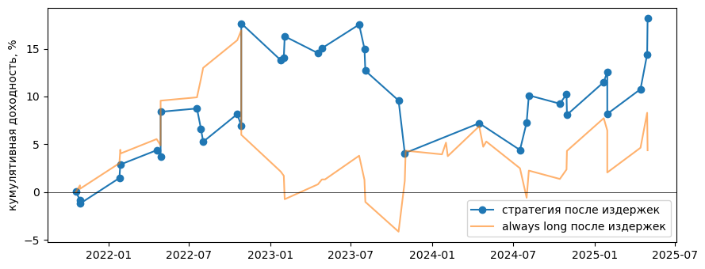
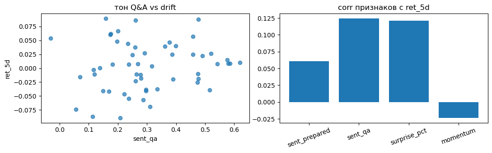

# Post-Earnings Drift

**Помогает ли тональность earnings calls предсказывать движение акций после отчётности?**

Финальный проект по машинному обучению. FinBERT превращает тексты выступлений менеджмента и Q&A в признаки; логистическая регрессия и нейросеть используют их вместе с EPS surprise и momentum.

**Авторы:** Туровинин Никита, Яблоков Артем, Федосов Александр · группа 4.

[Notebook с расчётами](project.ipynb) · [Краткий отчёт PDF](reports/project_summary.pdf) · [Полный notebook в PDF](reports/full_notebook.pdf) · [HTML-версия](reports/project.html)



На графике показана **накопленная сумма доходностей отдельных сделок**. Это event-study расчёт, без моделирования единого портфеля и распределения капитала между одновременно открытыми позициями.

## Главное

- **54 отчёта** AAPL, JNJ и CAT за январь 2021 – май 2025 года, по 18 на компанию.
- **0,714 accuracy** и **0,778 F1** у логистической регрессии на отложенной выборке из 14 отчётов.
- **0,64 accuracy** полной модели против **0,56 у baseline** на 45 временных out-of-fold прогнозах.
- **37 сделок** по уверенным прогнозам; средняя доходность после издержек **0,49% на сделку**.

Текстовые признаки добавили сигнал в этой выборке. Лучший общий результат получен при совместном использовании тональности, EPS surprise и momentum. Выборка небольшая, поэтому результат нельзя переносить на весь рынок.

## Данные и подход

| Компонент | Реализация |
|:---|:---|
| Компании | AAPL / Technology, JNJ / Healthcare, CAT / Industrials |
| Тексты | Earnings call transcripts из открытого датасета `defeatbeta/yahoo-finance-data` |
| Рыночные данные | Цены, EPS estimate, EPS actual и даты отчётности из Yahoo Finance / `yfinance` |
| Тональность | Готовый `ProsusAI/finbert`; текст делится на чанки по 200 слов, усредняется `P(positive) − P(negative)` |
| Четыре признака | Тональность prepared remarks, тональность Q&A, EPS surprise, momentum за 21 торговый день |
| Цель | Направление доходности `ret_5d` после отчёта |
| Модели | Логистическая регрессия и FCN на PyTorch с одним скрытым слоем |

Prepared remarks и Q&A оцениваются отдельно. При расчёте доходности учитывается, вышла отчётность до открытия рынка или после закрытия. Масштабирование признаков обучается только на train, в кросс-валидации заново внутри каждого fold.

## Качество прогноза

**Отложенный тест:** 40 ранних отчётов в train, 14 поздних в test. Граница временного разделения: 22 апреля 2024 года.

| Модель | Accuracy | F1 | ROC-AUC |
|:---|---:|---:|---:|
| Всегда UP | 0,571 | 0,727 | 0,500 |
| Только EPS surprise | 0,571 | 0,700 | 0,542 |
| **Логистическая регрессия** | **0,714** | **0,778** | 0,562 |
| FCN | 0,500 | 0,462 | **0,688** |

Логистическая регрессия лучше определяет класс при пороге 0,5. У FCN выше ROC-AUC, но ниже accuracy и F1: ранжирование вероятностей лучше, а решения о направлении движения слабее.

### Что добавляет текст

Для сравнения наборов признаков используется **TimeSeriesSplit с пятью разбиениями**: модель обучается на прошлом и прогнозирует следующий временной блок. Всего получено 45 out-of-fold прогнозов.

| Набор признаков | OOF accuracy |
|:---|---:|
| **Текст + EPS surprise + momentum** | **0,64** |
| Только текст | 0,58 |
| EPS surprise + momentum, без текста | 0,56 |
| Самый частый класс в train каждого fold | 0,56 |
| Только EPS surprise | 0,47 |

Один EPS surprise оказался слабым сигналом. Текст сам по себе обошёл baseline, а полный набор признаков дал лучший результат. Показатели этого сравнения относятся к OOF прогнозам и не совпадают с метриками отложенного теста выше.



Простая связь каждого отдельного признака с доходностью слабая. Высокая тональность Q&A сама по себе не гарантирует рост акции.

### Различия между компаниями

| Компания | OOF наблюдений | Accuracy | ROC-AUC |
|:---|---:|---:|---:|
| JNJ | 15 | 0,800 | 0,660 |
| CAT | 15 | 0,600 | 0,589 |
| AAPL | 15 | 0,533 | 0,536 |

Лучший результат получен для JNJ. На каждую отрасль приходится одна компания, поэтому это сравнение трёх представителей, а не подтверждение предсказуемости целых секторов.

## Торговая интерпретация

При **P(UP) > 0,55** открывается long, при **P(UP) < 0,45** short, остальные события пропускаются. Вход по закрытию первого дня реакции, выход через четыре торговых дня. Издержки составляют **10 б.п. за полную сделку**.

| Показатель | Модель | Always long |
|:---|---:|---:|
| Число сделок | 37 | 45 |
| Средняя доходность после издержек | 0,49% | 0,10% |
| Сумма доходностей после издержек | 18,2% | 4,4% |

Дополнительно в notebook приведено последовательное перемножение доходностей сделок модели: **17,8%**. Это отдельная метрика; она не равна сумме доходностей 18,2% и не является доходностью портфеля с учётом перекрывающихся позиций. Годовая доходность и Sharpe портфеля здесь не рассчитываются.

## Ограничения

- Всего три компании и 54 события; в отложенном тесте 14 наблюдений, в OOF анализе 45.
- Целевая доходность включает первую реакцию рынка, а торговая доходность начинается с закрытия дня реакции. Это разные окна.
- Порогам 0,45 / 0,55 не предшествует отдельная процедура выбора на train.
- Доступность полного транскрипта к моменту входа не подтверждена точными временными метками.
- Издержки упрощены; стоимость заимствования для short, market impact, распределение капитала и перекрытие сделок не моделируются.

## Структура и запуск

```text
.
├── README.md
├── project.ipynb               # Финальный notebook с сохранёнными outputs
├── data/                       # Датасет, кэш EPS, цен, sentiment и 54 транскрипта
├── reports/                    # Краткий отчёт, полный PDF и HTML
├── assets/figures/              # Графики из готового notebook
└── requirements.txt            # Зависимости
```

Для просмотра достаточно открыть [notebook](project.ipynb) на GitHub или скачать [краткий PDF](reports/project_summary.pdf). Для работы с кодом используйте Python 3.11 и запускайте Jupyter из корня проекта:

```bash
pip install -r requirements.txt
jupyter lab project.ipynb
```

В проект включены сохранённые данные и sentiment cache. FinBERT загружается только при отсутствии кэша тональности. Удаление кэша может потребовать подключения к внешним источникам и привести к изменению результатов.

Промежуточные версии, дубли и материалы курса сохранены локально в `.archive/` и исключены из Git. Расчёты при подготовке репозитория не запускались; графики и метрики взяты из сохранённых outputs.
